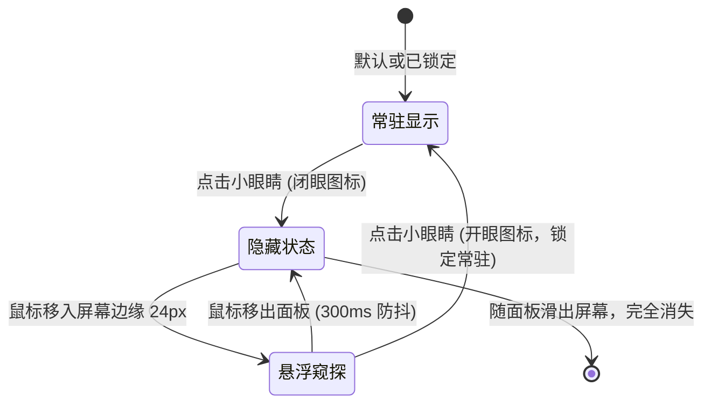

## 优化背景与体验痛点

在传统的静态文档与知识库设计中，侧边栏折叠与响应式交互常常存在几大硬伤：
1. **布局抖动（Layout Jitter）**：当侧边栏折叠或展开时，正文区域由于 Flex/Grid 容器重新计算剩余空间，导致正文内容发生水平方向的剧烈横跳。
2. **冗余控件与杂乱视觉**：侧边栏头部与顶部导航栏存在功能重叠的收缩按钮，折叠后残留小药丸浮条破坏界面纯粹度。
3. **分割线生硬切断视野**：左右两侧贯穿全屏的竖线边框使页面显得逼仄、生硬，缺乏现代留白呼吸感。
4. **阅读沉浸感不足**：顶部导航栏常驻占据垂直空间，而在大屏幕下主页两端又留出过多呆滞空白。

为了达到飞书知识库（Feishu / Lark Docs）级别的流畅度与高级质感，我们对站点的交互架构进行了全方位的深度重构。

## 核心设计与交互系统

### 1. 正文视口绝对居中（Zero Jitter 铁律）

为了彻底消灭侧边栏切换时正文的左右位移，我们将左右侧边栏从常规的文档流容器中抽离，采用**边缘停靠（Edge Docking）与视口中心线锚定**：

```text
+-------------------------------------------------------------------------+
| [Fixed 0~260px]               [正文 100vw / 2]           [Fixed 右侧大纲]  |
| 左侧全站目录树                 max-width: 820px              本页目录导航   |
| (滑入/滑出/悬浮)               X 坐标绝对恒定不变             (滑入/滑出/悬浮) |
+-------------------------------------------------------------------------+
```

无论左侧目录还是右侧大纲处于展开、折叠或悬浮窥探状态，中间正文的绝对像素坐标 `X = (window.innerWidth - 820) / 2` 永远固定不变，**从根本上消灭了任何一像素的横向晃动**。

### 2. 双翼对称悬浮窥探（Hover Peek）

借鉴飞书文档的边缘交互哲学，全站目录与本页大纲均演进为“双翼悬浮窥探”系统：
- **隐退即净屏**：收起侧边栏或大纲后，屏幕两侧不留任何悬浮把手或多余控件；
- **触边自然唤出**：当侧边栏处于折叠状态时，屏幕边缘激活 24px 的全透明感应区。鼠标靠近屏幕边缘，面板自然伴随柔和阴影平滑滑入视口；
- **防抖安全收回**：鼠标移出侧边栏后，配合 `matches(':hover')` 守护与 300ms 移出防抖，若用户未进行固定操作，面板自动平滑滑回边缘隐藏。

### 3. 小眼睛生命周期闭环

侧边栏与本页大纲均配备专属的双态小眼睛按钮，具备完整的展开、锁定与销毁生命周期：



> [!TIP]
> 小眼睛在悬浮窥探态下会自动呈现“开眼”图标并显示“锁定”提示，点击即可一键锁定常驻，让用户无需重新在顶部寻找开关。

## 顶部导航栏智能沉浸流（方案 B）

为了兼顾新访客的品牌与搜索认知，以及深度阅读时的无干扰沉浸体验，全站顶部导航栏落地了**智能滚动感知与触顶自然窥探**：

1. **首屏认知保障**：在页面最顶端（`scrollY <= 20px`）时，导航栏自然展示，方便直接发起全局搜索（`⌘K`）或切换主题；
2. **向下滚动自动隐退**：一旦向下滚动超过 10px，导航栏以 `260ms` 丝滑贝塞尔曲线自动缩入屏幕顶端上方，释放 100% 垂直视野；
3. **向上微滚瞬间召回**：在阅读过程中手指微微向上回滚，导航栏即刻平滑滑回；
4. **触顶自然唤出**：屏幕顶部配备 18px 感应区，鼠标划向屏幕顶端即可让导航栏如卷帘般轻柔滑落；打开搜索框或抽屉时自动保持显示，避免打断操作。

## 视觉质感打磨

- **消除生硬竖杠**：彻底去除左侧目录的 `border-right` 与右侧大纲的 `border-left`，以纯色留白和排版层级作为视觉分割；
- **底色浑然一体**：侧边栏底色与正文完全统一采用画布色 `var(--paper)`，树形标题改为透明悬浮浅变色；
- **全站基线对齐**：主页与文档页顶部导航栏统一铺满视口边缘，左侧品牌与右侧快捷按钮分别与下方的左翼侧边栏和右翼大纲形成垂直对齐基线。
